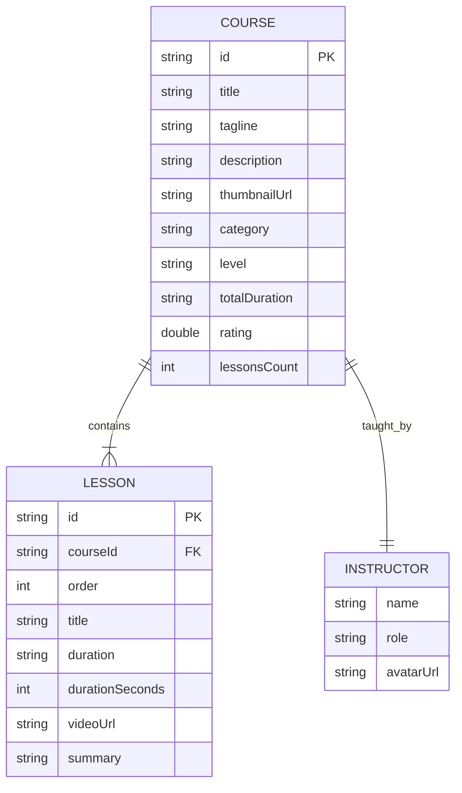
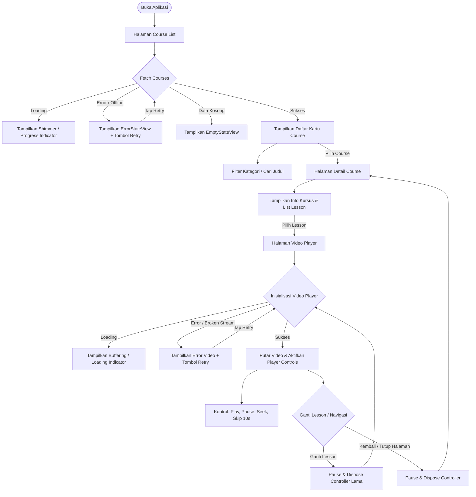
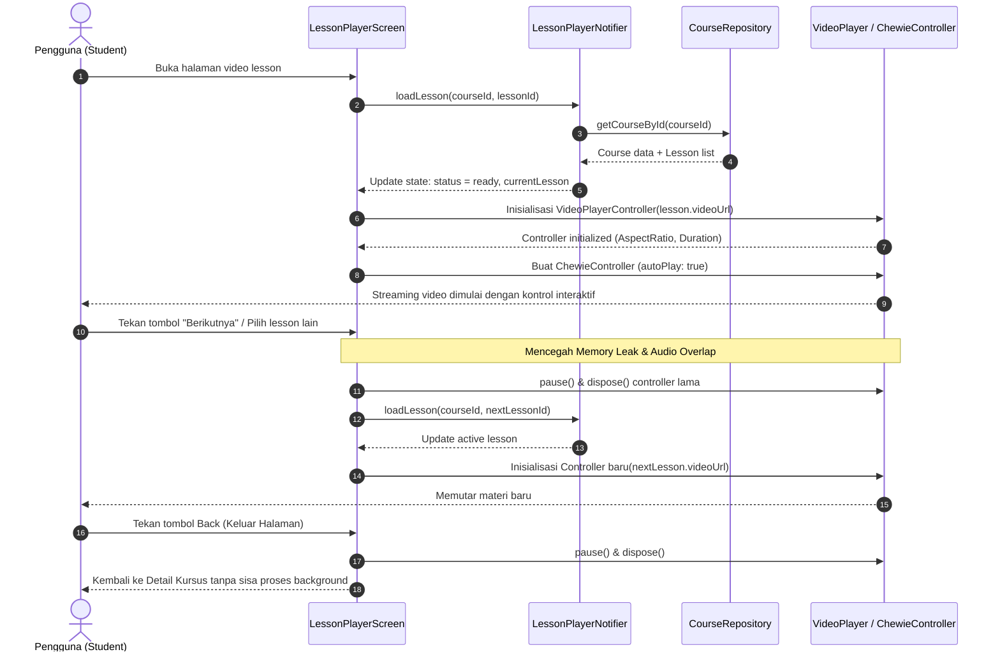

# System Design & Architecture Documentation
**Project:** Simple E-Learning Platform (Flutter Developer - Track B)  
**Author:** Candidate (Flutter Developer)  
**Date:** 2026-11-19  

---

## 1. Arsitektur Sistem (Feature-First Clean Architecture)

Aplikasi dibangun menggunakan pendekatan **Feature-First Clean Architecture**. Setiap fitur utama (`course`, `video_player`) diisolasi ke dalam modul tersendiri dengan tiga lapisan (*layers*): **Domain**, **Data**, dan **Presentation**.

```mermaid
flowchart TD
    subgraph Presentation Layer
        UI[Screens & Widgets\n- CourseListScreen\n- CourseDetailScreen\n- LessonPlayerScreen]
        Notifier[Riverpod Notifiers & Providers\n- courseListControllerProvider\n- courseDetailProvider\n- lessonPlayerControllerProvider]
    end

    subgraph Domain Layer
        Entities[Pure Entities\n- Course\n- Lesson\n- Instructor]
        Contract[Repository Contract\n- CourseRepository interface]
    end

    subgraph Data Layer
        RepoImpl[Repository Implementation\n- MockCourseRepository]
        DataSource[Data Sources\n- LocalCourseDataSource / REST API]
        Models[Data Models & DTOs\n- CourseModel\n- LessonModel\n- InstructorModel]
    end

    UI -->|User Interactions / Watch State| Notifier
    Notifier -->|Calls| Contract
    RepoImpl -.->|Implements| Contract
    RepoImpl -->|Queries| DataSource
    DataSource -->|Parses JSON| Models
    Models --|> Entities
    RepoImpl -->|Returns Entities| Notifier
    Notifier -->|AsyncValue State| UI
```

### Keunggulan Arsitektur:
1. **Separation of Concerns:** Layer UI tidak pernah berinteraksi langsung dengan berkas JSON atau dependensi network HTTP.
2. **High Testability:** Layer domain dan data dapat diuji dengan Unit Test murni tanpa overhead Flutter UI.
3. **Painless API Migration:** Pergantian mock data ke backend riil cukup dengan mengganti implementasi `CourseRepository` tanpa menyentuh UI maupun Riverpod Notifier.

---

## 2. Model Data & ERD (Entity Relationship Diagram)



---

## 3. Flowchart Alur Navigasi & Pemutaran Video



---

## 4. Sequence Diagram: Siklus Hidup Video & Manajemen Memori

Diagram ini memperlihatkan alur pembuatan, pemutaran, pergantian materi (*switching lesson*), dan penghapusan controller (*disposal*) untuk mencegah kebocoran memori (*memory leak*):



---

## 5. Kontrak Mock API & Panduan Migrasi ke API Riil

### 5.1 Format Respons JSON
Data dikemas dalam struktur standar REST API:
```json
{
  "status": "success",
  "message": "Courses retrieved successfully",
  "data": [
    {
      "id": "course-1",
      "title": "Mastering Flutter & Riverpod Architecture",
      "tagline": "Pelajari state management modern, clean architecture, dan scalable mobile code.",
      "description": "Kursus komprehensif untuk menguasai Flutter dari level dasar hingga mahir...",
      "instructor": {
        "name": "Budi Santoso",
        "role": "Senior Mobile Engineer",
        "avatar_url": "https://images.unsplash.com/photo-1534528741775-53994a69daeb?w=150"
      },
      "thumbnail_url": "https://images.unsplash.com/photo-1517694712202-14dd9538aa97?w=600",
      "category": "Mobile Development",
      "level": "Intermediate",
      "total_duration": "45 menit",
      "rating": 4.9,
      "lessons_count": 3,
      "lessons": [
        {
          "id": "lesson-101",
          "course_id": "course-1",
          "order": 1,
          "title": "Pengenalan Arsitektur E-Learning & Setup",
          "duration": "09:56",
          "duration_seconds": 596,
          "video_url": "https://commondatastorage.googleapis.com/gtv-videos-bucket/sample/BigBuckBunny.mp4",
          "summary": "Memahami pondasi arsitektur Feature-First, pemilihan package, dan struktur folder."
        }
      ]
    }
  ]
}
```

### 5.2 Cara Mengganti Mock Data dengan Real API
Untuk beralih ke backend riil, kita hanya perlu membuat class `HttpCourseRepository`:

```dart
class HttpCourseRepository implements CourseRepository {
  final Dio dio;
  HttpCourseRepository({required this.dio});

  @override
  Future<List<Course>> getCourses() async {
    final response = await dio.get('/api/v1/courses');
    final data = response.data['data'] as List<dynamic>;
    return data.map((json) => CourseModel.fromJson(json)).toList();
  }

  @override
  Future<Course> getCourseById(String id) async {
    final response = await dio.get('/api/v1/courses/$id');
    return CourseModel.fromJson(response.data['data']);
  }

  @override
  Future<Lesson> getLessonById(String courseId, String lessonId) async {
    final course = await getCourseById(courseId);
    return course.lessons.firstWhere((l) => l.id == lessonId);
  }
}
```

Lalu cukup ubah provider di `mock_course_repository.dart` atau file dependency injection:
```dart
final courseRepositoryProvider = Provider<CourseRepository>((ref) {
  // Ganti MockCourseRepository dengan HttpCourseRepository
  return HttpCourseRepository(dio: ref.watch(dioProvider));
});
```
Tidak ada satu baris pun kode di layer Presentation (UI, StateNotifier, Screens) yang perlu diubah.

---

## 6. Alasan Pemilihan Library Utama

1. **`flutter_riverpod`:**
   * Diutamakan dalam kriteria penilaian assessment.
   * *Compile-time safe*, tidak membutuhkan `BuildContext` untuk membaca state di repository/notifier.
   * Sangat mudah di-mock saat unit test melalui `ProviderContainer(overrides: [...])`.
2. **`video_player` & `chewie`:**
   * `video_player` adalah plugin resmi dari Flutter Team yang stabil, mendukung video streaming HTTPS dengan decoding hardware native.
   * `chewie` menyediakan wrapper antarmuka Material video player yang ramah pengguna dengan kontrol play/pause, seek scrubbing, buffering state, dan fullscreen.
3. **`go_router`:**
   * Solusi resmi navigasi deklaratif (Navigator 2.0).
   * Mendukung parameter path dinamis (`/courses/:courseId/lessons/:lessonId`) dan penanganan *deep link* serta navigasi *back* yang bersih.

---

## 7. Catatan Asumsi & Keterbatasan

### Asumsi:
* Pengguna bertindak sebagai Siswa (*Student*), tidak memerlukan fitur autentikasi login atau dashboard admin (sesuai brief assessment).
* URL video streaming menggunakan URL video publik Google Storage bucket yang valid, aman, dan mendukung byte-range HTTP request untuk seeking.

### Keterbatasan (*Known Limitations*):
* Fitur download video offline belum diimplementasikan dengan penyimpanan disk lokal terenkripsi (saat ini pemutaran dilakukan via direct video streaming / network caching).
* Belum ada fitur pencatatan progres menit terakhir menonton yang disimpan ke persistent local database (misal: Hive / SQLite).


---

## 8. Design System & Design Tokens (`lib/core/design_system/`)

Untuk menjamin konsistensi antarmuka pengguna (UI), kecepatan *reusability*, dan kemudahan *theming* di masa mendatang, aplikasi telah mengimplementasikan arsitektur **Design System** mandiri.

```
lib/core/design_system/
├── design_system.dart          # Single barrel export untuk seluruh token & komponen
├── tokens/
│   ├── app_colors.dart         # Semantic color palette & surface tones
│   ├── app_typography.dart     # Standardized text styles & scale (headings, body, captions)
│   ├── app_spacing.dart        # 4-point spacing scale, spacers, dan padding presets
│   ├── app_radius.dart         # Border radius constants & shapes
│   └── app_shadows.dart        # Depth elevation & drop shadows
└── components/
    ├── app_button.dart         # Multi-variant button (Primary, Secondary, Outline, Text) + Loading
    ├── app_search_field.dart   # Search text input with icon prefix, clear button & callbacks
    ├── app_badge.dart          # Contextual badge/chip (Category, Difficulty Level, Rating, Info)
    ├── app_empty_state.dart    # Centered state view with icon, title, description & action
    ├── app_error_state.dart    # Error state view with retry button
    └── app_loading_indicator.dart # Standard circular progress indicator with optional message
```

### 8.1 Keuntungan Design Tokens & Components
1. **Single Source of Truth:** Semua padding, margin, radius sudut, warna teks/permukaan didefinisikan secara tersentralisasi pada token. Perubahan estetika aplikasi dapat dilakukan pada level token tanpa menyentuh ratusan baris kode widget.
2. **Material UI Decoupled Compatibility:** Menggunakan `package:material_ui/material_ui.dart` yang kompatibel penuh dengan Flutter 3.50+.
3. **High Accessibility & Reusability:** Komponen seperti `AppButton` dan `AppBadge` menangani status loading, disabilitas, dan kontras warna secara otomatis.
